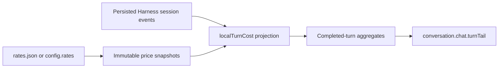

# Architecture

## Host and projection

`index.js` registers the `localTurnCost` projection through `sessionProjections` and opens the `local_turn_cost_prices` storage domain. A hash of the rate configuration identifies each saved snapshot. The projection checkpoint version incorporates the algorithm version and complete price catalog so incompatible caches are rebuilt.

`src/projection.js` folds turn, step, retry and assistant-settlement events. A pending attempt keeps the final usage sample, commits on retry/step/turn boundaries, and aggregates lines by provider, model, price version, period and completeness. Only ended turns are published to the client. Fork-inherited records are excluded from new session totals.

`src/pricing.js` validates configuration and usage. Prices have at most six decimals per million tokens; multiplication produces integer trillionths of currency serialized as decimal strings. Reasoning tokens are not an additional charge. Missing counters are inferred as zero only when the exact total proves it.

## Price history

The initial catalog entry starts at the configured `effectiveFrom`; subsequent changes start when loaded. A new catalog also respects its own `effectiveFrom`, so a future tariff is unavailable until that date. Catalog selection uses attempt-start time; peak windows use UTC+8, weekdays and configured holiday dates. The calendar is deliberately bounded. Explicit provider rows override official-route aliases.

## Client

`src/client-factory.js` uses Harness-provided React, `useProjection` and `conversation.chat.turnTail`. `scripts/build.mjs` generates the standalone `client.js` and embeds locale dictionaries. The client neither scans chat DOM nor changes conversation messages. Registration and styles are removed on disposal.

## Limits

Storage grows with turn count and distinct model/price combinations. Unknown usage cannot be recovered from rendered text. Independent subagent sessions and model calls outside the current session are excluded. Price history is not an authoritative financial ledger. Runtime service and slot APIs depend on the tested Harness version.
